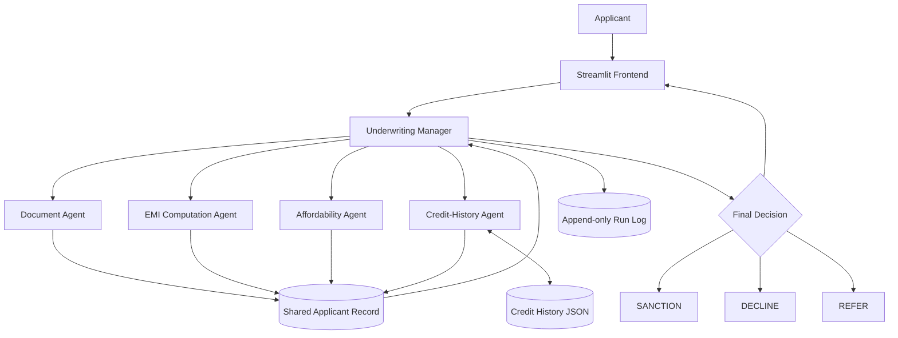

# LoanSphere – Multi-Agent Loan Underwriting System

## 1. Project Overview

LoanSphere is a multi-agent loan underwriting system developed using Python and Microsoft Semantic Kernel. It evaluates loan applications through specialized agents responsible for document validation, EMI computation, affordability analysis, and credit-history assessment.

A central Underwriting Manager coordinates these agents and generates one of three decisions: **SANCTION, DECLINE, or REFER**.

The project also provides a Streamlit-based banking dashboard for submitting applications, viewing assessment results, and reviewing application history.

## 2. Technology Stack

- **Programming Language:** Python 3.10
- **Agent Framework:** Microsoft Semantic Kernel
- **Frontend:** Streamlit
- **Data Storage:** JSON
- **Execution Logging:** JSONL
- **Testing:** Pytest

## 3. Agent Roster and Responsibilities

| Agent | Responsibility |
|---|---|
| Document Agent | Extracts and validates applicant and loan information. |
| EMI Computation Agent | Calculates monthly EMI and total repayment using the reducing-balance method. |
| Affordability Agent | Evaluates monthly financial obligations against the income threshold. |
| Credit-History Agent | Retrieves previous credit records and identifies potential credit risks. |
| Underwriting Manager | Coordinates specialist agents, validates their results, and generates the final decision. |

Each agent is implemented in a separate Python module under the `agents/` directory.

## 4. Tools Used by Each Agent

Each agent exposes two Semantic Kernel functions that call plain Python utility functions.

| Agent | Tool 1 | Tool 2 |
|---|---|---|
| Document Agent | `extract_application_details()` | `validate_application_details()` |
| EMI Agent | `calculate_emi()` | `calculate_total_repayment()` |
| Affordability Agent | `calculate_obligation_ratio()` | `evaluate_affordability()` |
| Credit-History Agent | `lookup_credit_record()` | `evaluate_credit_history()` |
| Underwriting Manager | `validate_specialist_results()` | `create_decision_record()` |

The utility functions are maintained separately under the `tools/` directory. Semantic Kernel decorators expose the agent functions for plugin registration.

## 5. System Architecture

The system follows a manager–specialist architecture.

1. The applicant submits loan details through the Streamlit frontend.
2. The Underwriting Manager receives the application.
3. The Document Agent extracts and validates the required information.
4. The EMI Agent calculates the proposed monthly EMI and total repayment.
5. The Affordability Agent evaluates the applicant's monthly financial obligations.
6. The Credit-History Agent checks previous loan records.
7. The specialist agents update a shared ApplicantRecord.
8. The Underwriting Manager validates the results and generates the final decision.
9. The result and execution trace are recorded in the application log and displayed on the dashboard.

### Architecture Diagram



## 6. Memory and Data Storage

The system uses a local JSON file as its credit-history memory.

**File:** `memory/credit_records.json`

It stores synthetic applicant credit records containing:
- Previous loan count
- Missed payment count
- Default count

The shared `ApplicantRecord` maintains the current application's extracted information, computed EMI, affordability verdict, credit status, decision, justification, and execution trace.

Application executions are stored in `logs/run_log.jsonl`. Each new execution is appended as a separate JSON record, preserving previous entries.

## 7. Decision-Making Rules

The system applies the following rules:

- **SANCTION:** Required information is valid, affordability is satisfied, and credit history is clear.
- **DECLINE:** Total monthly financial obligations exceed 40% of net monthly income.
- **REFER:** Required information is missing or invalid, or credit history is unknown or indicates risk.

The EMI is calculated using the reducing-balance formula.

The affordability ratio is:

`(Existing EMI + Proposed EMI) / Net Monthly Income × 100`

The affordability threshold is 40%.

## 8. Installation and Execution

### Prerequisites

- Python 3.10
- pip
- Visual Studio Code or another Python IDE

### Install dependencies

```bash
pip install semantic-kernel==1.46.0
pip install pandas pytest ipykernel streamlit
```

### Run the application

Activate the virtual environment and execute:

```bash
streamlit run app.py
```

The Streamlit dashboard opens locally, usually at:

`http://localhost:8501`

### Run automated tests

```bash
python -m pytest tests -v
```

## 9. Testing and Failure Handling

The system was tested with four application scenarios:

| Scenario | Expected Decision | Reason |
|---|---|---|
| Applicant APP001 | SANCTION | Clear credit history and affordability satisfied. |
| Applicant TEST003 | DECLINE | Financial obligations exceed the 40% threshold. |
| Applicant APP002 | REFER | Credit history contains defaults and missed payments. |
| Applicant NEW004 | REFER | Required monthly income information is unavailable. |

**Failure-handling example:** When monthly income is missing, the Document Agent identifies the missing field. The Underwriting Manager stops further assessment and refers the application instead of assuming an income value or calculating an affordability ratio.

This prevents an incomplete application from receiving an unsupported sanction decision.

## 10. Conclusion

LoanSphere demonstrates how multiple specialized agents can collaborate to automate a preliminary loan underwriting workflow. By combining deterministic financial calculations, credit-history checks, shared application state, and centralized decision-making, the system provides a structured and traceable approach to loan assessment.

The Streamlit frontend makes the system accessible through a simple banking dashboard, while Semantic Kernel provides the agent plugin structure.
